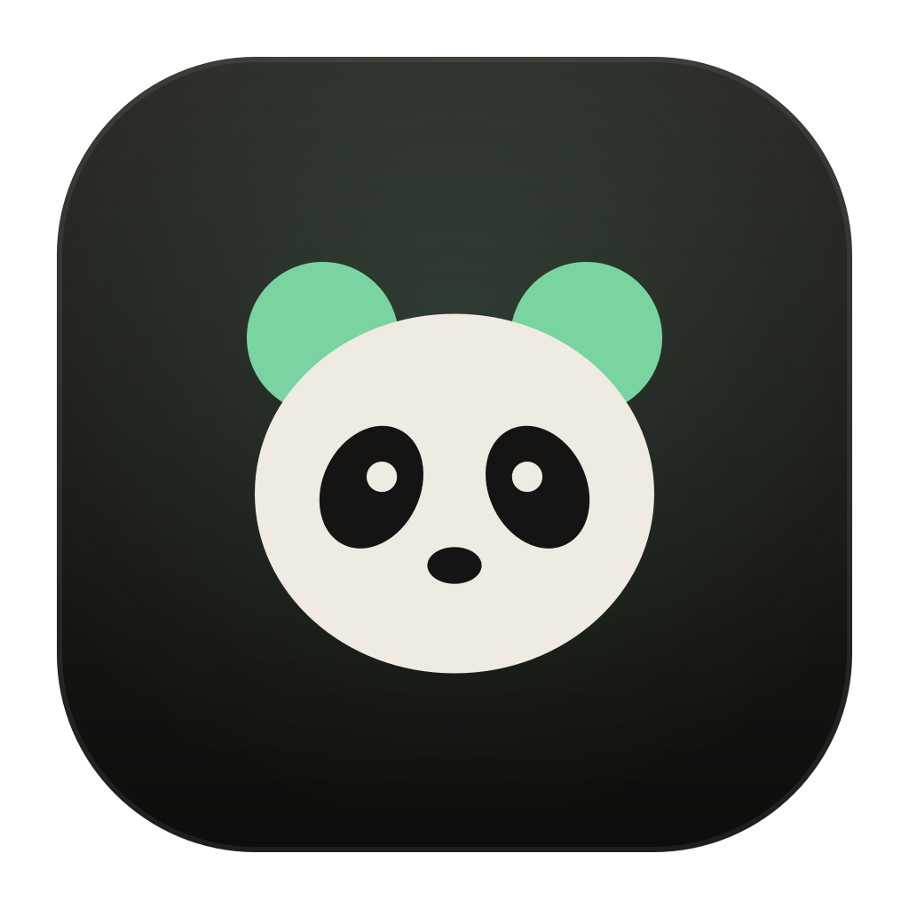
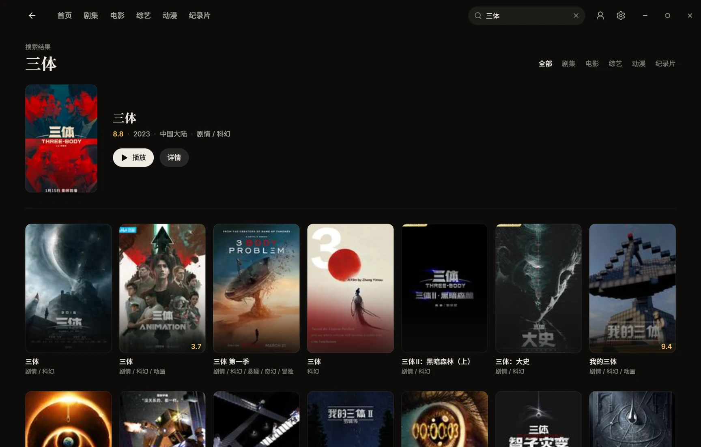
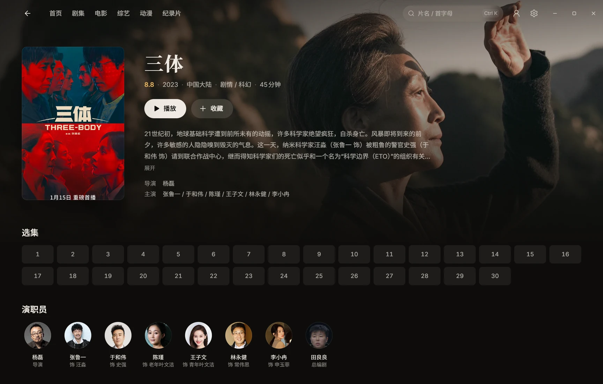
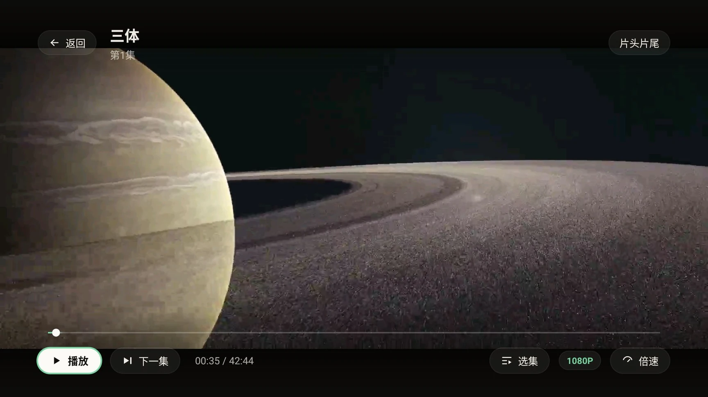

# Panda

Panda 是一款面向 Windows 桌面和 Android TV 的影视客户端。可以按类型、地区和年份挑片，也可以用片名或拼音首字母搜索。收藏和观看进度保存在当前设备，下次打开作品就能接着看。

[**下载最新版本**](https://github.com/7788dev/PandaTv/releases/latest) · [界面预览](#界面预览) · [从源码运行](#从源码运行)


## 下载安装

在发布页的 **Assets**（附件）中选择对应设备的安装包。桌面版和电视版各自使用独立的版本号。[查看所有版本](https://github.com/7788dev/PandaTv/releases)

| 设备 | 下载文件 | 安装方式 |
| --- | --- | --- |
| Windows x64 | `Panda-<版本>-Setup.exe` | 在电脑上运行安装程序，按提示完成安装。 |
| Android TV 5.1 及以上（API 22+） | `Panda-TV-<版本>.apk` | 将 APK 传到电视或电视盒子，用文件管理器打开安装。 |

如需校验文件，可将安装包的 SHA-256 与同一发布页的 `SHA256SUMS.txt` 比对。

## 界面预览

点击截图可查看大图。

### Windows 桌面

按 `Ctrl` + `K` 打开搜索框。例如，输入 `ST` 可以查找《三体》。进入详情页后，可以先读简介、看演职员表，再选一集播放。

| 搜索结果 | 剧集详情 |
| --- | --- |
| [](docs/screenshots/windows-search.webp) | [](docs/screenshots/windows-detail.webp) |

### Android TV

用遥控器方向键移动绿色焦点框，按确认键打开作品。播放时可以选集、调整倍速或跳到进度条上的其他位置。可选集数和播放线路取决于当前片源。下图截自 Android 模拟器中的原生电视客户端。

| 电影频道 | 播放控制 |
| --- | --- |
| [](docs/screenshots/tv-movies.webp) | [](docs/screenshots/tv-player.webp) |

## 从源码运行

**Windows 桌面** 使用 Node.js 24 和 npm。首次检出后，在仓库根目录安装依赖并启动开发版。

```powershell
npm ci
npm run dev
```

**Android TV** 需要 JDK 21、Android SDK Platform 37 和 Build Tools 37.0.0。在 Android Studio 中配置 SDK，或设置本机的 `ANDROID_HOME`，然后构建调试包。

```powershell
cd tv
.\gradlew.bat assembleDebug
```

生成的调试包位于 `tv/app/build/outputs/apk/debug/app-debug.apk`。

## 代码与验证

| 模块 | 实现与检查 |
| --- | --- |
| Windows 界面 | [React 页面和样式](src/renderer/) 通过 [preload](src/preload/index.ts) 与主进程通信。运行 `npm run build` 后，可用 `npm run test:e2e` 串行验证联网搜索和播放。 |
| 数据与播放器 | [主进程](src/main/) 负责目录、持久化、探测和媒体代理。运行 `npm test` 检查行为，`npm run check:rules` 检查规则参数。 |
| 桌面离线交互 | 安装 FFmpeg 后运行 `npm run test:media` 生成测试媒体，再运行 `npm run build` 和 `npm run test:e2e:fixture`。测试使用编译后的 Electron 应用、网络边界数据和可解码视频。 |
| Android TV | [Kotlin 客户端](tv/app/src/main/java/app/panda/tv/) 使用原生 Views、Leanback 和 Media3。进入 `tv/` 后运行 `.\gradlew.bat testDebugUnitTest lintRelease assembleRelease`。 |
| 两端播放规则 | 修改[规则参数](resources/rule-calibration.json)或[共享规则](src/shared/rules/)后，从仓库根目录运行 `node scripts/export-tv-vectors.mjs`，检查生成差异并运行两端测试。 |

构建安装包、签名与发布步骤见[发布说明](docs/ci-release.md)。历次版本的测试结果和设备记录见[交付报告](docs/delivery-report.md)。

## 友情链接

[LINUX DO](https://linux.do/)
